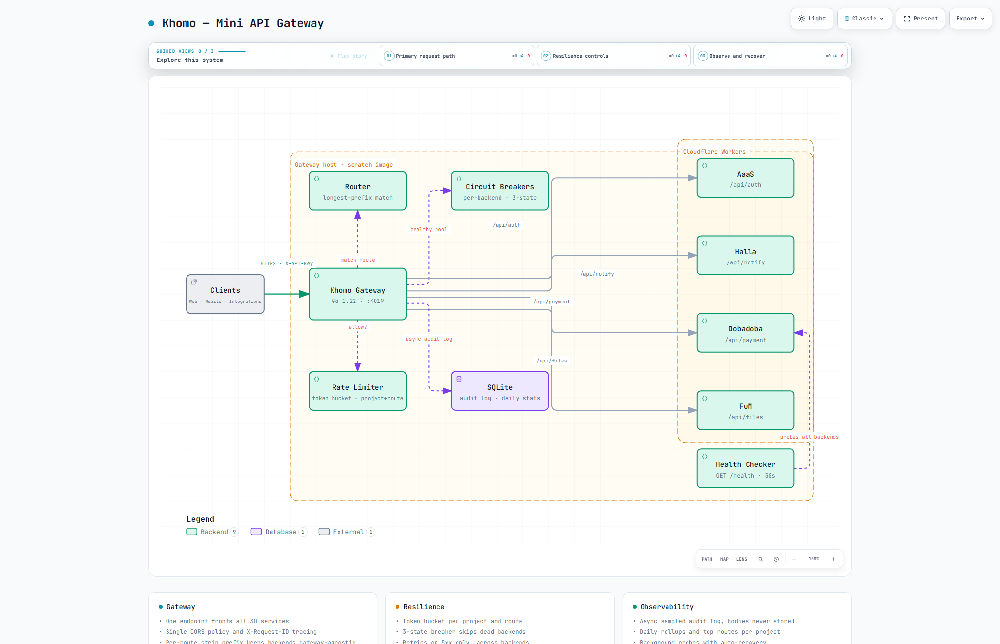

# Khomo — Day 28

[](https://go.dev) [](https://pkg.go.dev/modernc.org/sqlite) [](https://www.docker.com) [](LICENSE)

**Local:** `http://localhost:4019` — `GET /health` → `{"service":"Khomo — API Gateway","status":"ok","version":"1.0.0"}` | `GET /gateway/admin/routes` → `{"success":true,"count":4,"routes":[...]}`

Production-grade mini API gateway. **Go stdlib + `httputil.ReverseProxy` + pure-Go SQLite**. Front door for the 30 Services challenge — one endpoint, one CORS policy, one rate-limit layer, one audit trail.

> **Docs:** [Interactive Architecture](docs/khomo-architecture.html) • [docs/README.md](docs/README.md) • [API](docs/API.md) • [OpenAPI](docs/openapi.yaml) • [Deployment](docs/DEPLOYMENT.md) • [Integration](docs/INTEGRATION.md) • [Security](docs/SECURITY.md) • [TDS](Khomo.md)

## Architecture — Interactive + Big Preview

[](docs/khomo-architecture.html)

> **Big preview** (2048×1320 light — 177 KB) — click for interactive pan/zoom/trace + light/dark + PNG export. Also available: [dark variant](docs/khomo-architecture.visual-check.2048x1320.dark.png) & [1440×900 light](docs/khomo-architecture.visual-check.1440x900.light.png). Full showcase: 9/9 checks, 0 errors.

## Stack
- **Runtime:** Go 1.22+ — single static binary (~8 MB, ~30 ms cold start)
- **Proxy:** `net/http` + `httputil.ReverseProxy` (same primitive as Cloudflare/Kong)
- **Router:** longest-prefix matcher, zero third-party deps
- **DB:** pure-Go SQLite (`modernc.org/sqlite`, WAL) — no CGO, `FROM scratch` works
- **Resilience:** custom 3-state circuit breaker + token-bucket rate limiter (stdlib only)
- **Deploy:** `FROM scratch` Docker (~10 MB) / `docker compose` with 128M limit

## Project Structure
```
.
├── cmd/khomo/main.go            # wiring, graceful shutdown, CORS
├── internal/
│   ├── config/config.go         # env → Config + slog setup
│   ├── db/{db,queries}.go       # open/migrate, projects/routes/backends/logs/stats
│   ├── auth/auth.go             # X-API-Key → project
│   ├── routing/{router,registry}.go  # longest-prefix match, 30s background reload
│   ├── proxy/{proxy,roundrobin,headers}.go  # ReverseProxy pools + header pipeline
│   ├── circuit/breaker.go       # 3-state breaker + half-open limiter (+ tests)
│   ├── ratelimit/bucket.go      # token bucket per project:route (+ tests)
│   ├── health/checker.go        # background GET /health pings
│   ├── observability/logger.go  # async sampled audit queue (PII-safe)
│   └── handlers/{gateway,admin,health,stats}.go
├── migrations/0001_init.sql     # projects, routes, backends, request_log, circuit_state, daily_summary
├── scripts/seed.sh              # seeds the 4 spec services via admin API
├── docs/
│   ├── README.md                # overview + banner
│   ├── API.md                   # full endpoint spec
│   ├── openapi.yaml             # OpenAPI 3.0.3 (fixed surface)
│   ├── DEPLOYMENT.md            # local + docker + VPS
│   ├── INTEGRATION.md           # clients + service-to-service
│   ├── SECURITY.md              # keys, PII, limits
│   └── khomo-architecture.html  # interactive diagram + preview PNGs
├── Dockerfile                   # FROM scratch, ~10MB
├── docker-compose.yml           # 128M limit, khomo_data volume
├── .env.example                 # → .env (local config, gitignored)
├── Khomo.md                     # TDS v1.0.0
└── README.md
```

## Quick Start (15 mins)

```bash
# 1. Deps
go mod download

# 2. Config
cp .env.example .env
# edit .env (PORT, DATABASE_PATH, CB_* thresholds)

# 3. Run
go run ./cmd/khomo
# → Khomo listening port=4019 routes=0

# 4. Seed the 4 spec services (AaaS/Halla/Dobadoba/FuM)
BASE=http://localhost:4019 ./scripts/seed.sh
# → edit script URLs first if your Workers differ

# 5. Verify
curl http://localhost:4019/health
curl http://localhost:4019/gateway/admin/routes
```

```bash
# ——— OR with Docker ———
docker compose up -d
BASE=http://localhost:4019 ./scripts/seed.sh
curl http://localhost:4019/health
```

## API

One pipeline handles every proxied call — full spec in [docs/API.md](docs/API.md) + [openapi.yaml](docs/openapi.yaml):

1. Assign/propagate `X-Request-ID` → 2. longest-prefix route match (`404`) → 3. `X-API-Key` auth when required (`401`) → 4. rate limit (`429`) → 5. gateway headers → 6. per-route transforms → 7. proxy with timeout + 5xx retries → 8. async audit log

### Proxy any route ⭐ (dynamic — registered via admin)
```bash
curl -X POST http://localhost:4019/api/auth/register \
  -H "X-API-Key: client-khomo-key-2026" \
  -H "Content-Type: application/json" \
  -d '{"email":"test@example.com","password":"securepass123"}'
```
Backend receives `POST /register` (`/api/auth` stripped) + `X-Request-ID`, `X-Gateway: Khomo/1.0`, `X-Forwarded-For`, `X-Project: Primary Client`. `Cookie` stripped per route config.

### GET /health
`200` → `{ service, version: "1.0.0", status: "ok", routes, backends_total, backends_healthy, last_reload, timestamp }`

### GET /gateway/admin/routes
`200` → `{ success: true, count, routes: [{ id, path_prefix, service_name, strip_prefix, require_auth, timeout_ms, max_retries, websocket, backend_list, backends }] }`

### POST /gateway/admin/routes
```json
{ "path_prefix": "/api/pay", "service_name": "Dobadoba", "timeout_ms": 30000, "max_retries": 1 }
```
`200` (reloaded) | `400` missing fields | `409` prefix exists

### POST /gateway/admin/backends
```json
{ "route_id": 3, "base_url": "https://dobadoba.emmanueljin101.workers.dev", "weight": 1 }
```
`200` (reloaded) | `400` missing fields

### DELETE /gateway/admin/routes/{id} · DELETE /gateway/admin/backends/{id}
`200` (reloaded) | `400` bad id — route delete cascades to its backends

### POST /gateway/admin/projects · GET /gateway/admin/projects
```json
{ "name": "Mobile App", "api_key": "<generate>", "rate_limit_per_minute": 600 }
```
`201` → `{ success: true, id }` | `409` key exists

### POST /gateway/admin/reload
`200` → `{ success: true, reloaded_at }` — picks up out-of-band DB edits, re-syncs proxy pools

### GET /gateway/stats?days=30 ⭐ (needs `X-API-Key`)
`200` → `{ success, project, days, totals: { total_requests, success_2xx, client_errors_4xx, server_errors_5xx, gateway_errors, avg_duration_ms, total_bytes_out, total_retries }, top_routes }` | `401` bad key

### Gateway status codes
`401` missing/invalid key · `404` no route · `413` body too large · `429` rate limited · `502` backend 5xx exhausted · `503` all backends circuit-open

## Testing (cURL) — Local

```bash
BASE="http://localhost:4019"; K="client-khomo-key-2026"

# health + routes
curl -s $BASE/health
curl -s $BASE/gateway/admin/routes

# proxy + strip_prefix (backend sees /register, Cookie stripped)
curl -X POST $BASE/api/auth/register -H "X-API-Key: $K" \
  -H "Content-Type: application/json" -d '{"email":"test@example.com"}'

# 401 / 404
curl -X POST $BASE/api/auth/register -H "Content-Type: application/json" -d '{}'
curl -s $BASE/api/nonexistent/whatever -H "X-API-Key: $K"

# round-robin (2 backends → alternates A,B,A,B)
for i in 1 2 3 4; do curl -s $BASE/api/auth/ping -H "X-API-Key: $K"; done

# rate limit (limit 5/min → 5×200 + 3×429)
for i in $(seq 1 8); do curl -s -o /dev/null -w "%{http_code}\n" \
  $BASE/api/auth/ping -H "X-API-Key: limited-key-1"; done

# circuit breaker (dead backend → 5×502 then 503 open)
for i in $(seq 1 7); do curl -s -o /dev/null -w "%{http_code}\n" \
  $BASE/api/dead/x -H "X-API-Key: $K"; done

# stats
curl -s "$BASE/gateway/stats?days=30" -H "X-API-Key: $K"
```

Unit: `go test ./...` (routing, circuit ×4, ratelimit ×3, proxy ×5) · `go vet ./...` clean · `gofmt -l .` clean.

## Integration (for Day 29+ services)

1. Point clients at **one** base URL — no per-service hosts
2. Send `X-API-Key: <project-key>` on every call
3. Read `X-Request-ID` from responses for cross-service tracing
4. Service-to-service goes through Khomo too (central limits + one audit trail)
5. *Add* a service = 2 admin calls (route + backend), zero client changes

```javascript
// Before: 30 base URLs. After: one.
const API = 'https://api.yourdomain.com';
await fetch(`${API}/api/auth/register`, {
  method: 'POST',
  headers: { 'X-API-Key': USER_API_KEY, 'Content-Type': 'application/json' },
  body: JSON.stringify({ email, password }),
});
```

## Security Notes

- Tenancy: per-project `X-API-Key` + per-route token buckets (5/min test key → 5×200 + 3×429 verified)
- Admin API has **no auth** — bind `127.0.0.1` or front with mTLS; never expose raw
- Bodies never logged (PII) — audit keeps method/path/status/sizes only, query strings excluded
- Edge caps: 10 MB default max body (`413`), per-route timeouts, hop-by-hop headers stripped
- No secrets in repo — `.env` gitignored, `.env.example` documents every var

### Ponytail decisions (skipped → when to add)
- No Gin/Chi/ORM — stdlib routing + raw SQL is shorter; add when route shapes outgrow prefixes
- No sony/gobreaker — 80-line 3-state breaker with half-open cap; add when needing Prometheus export
- No body logging — PII risk; add sampled debug only with field redaction
- No mTLS gateway→backends — add when traffic leaves Cloudflare
- No distributed rate limit — single-instance buckets; add Redis when running >1 replica
- Fixed spec bugs instead of working around: missing `preserveHost`, unset `ProjectID` (stats were aggregating under 0), stale proxy pools on reload

## Deploy Checklist

- [ ] `.env` set (`PORT`, `DATABASE_PATH`, `CB_*`, `LOG_LEVEL=info`)
- [ ] `migrations/0001_init.sql` auto-applies on boot (works from `/migrations` in scratch image)
- [ ] `scripts/seed.sh` run (real Workers URLs)
- [ ] `GET /health` → `routes: 4, backends_healthy: 4`
- [ ] Proxy smoke test per route + `401` without key
- [ ] Admin port firewalled (localhost-only or mTLS)
- [ ] Share base URL in WhatsApp

## License
MIT — reuse for all 30 services.
